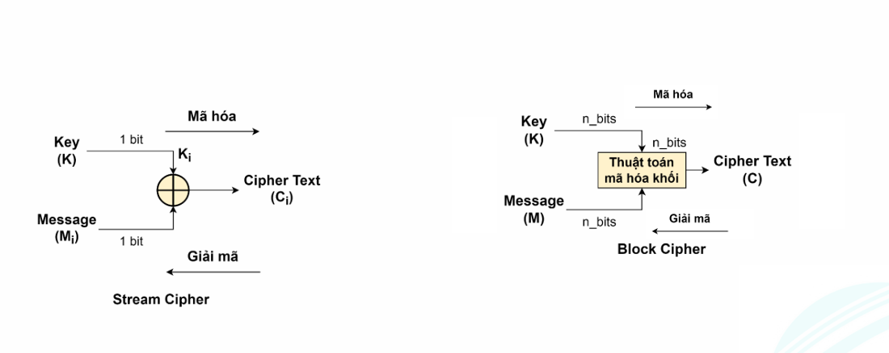

# Các kỹ thuật mã hoá cổ điển
## Khái niệm
+ Plaintext (p): là dữ liệu ban đầu trước khi mã hoá
+ Ciphertext (C): là dữ liệu đã được mã hoá
+ Encryption/Enciphering (E): p -> C
+ Cryptography: lĩnh vực nghiên cứu thiết kế các kỹ thuật mã hóa
+ Các loại mã hoá:
	+ Phương thức mã hoá:
		+ Thay thế
		+ Đổi vị trí
		+ Kết hợp
	+ Số lượng khoá:
		+ Một khoá
		+ Hai khoá
		+ Không có khoá
	+ Cách xử lý dữ liệu:
		+ Mã hoá khối
		+ Mã hoá dòng

+ Cryptanalysis:
	+  là quá trình dịch ngược các dữ liệu đã mã hóa thành các chuỗi ban đầu mà không cần các kiến thức về quá trình mã hóa. 
	+ Có 2 loại:
		+ Cryptanalytic attack: sử dụng cách phân tích các đặc điểm của plaintext, thậm chí là cặp plaintext-cipher text để tìm khóa.
		+ Brute-force attack là kỹ thuật mà kẻ tấn công thử hết tất cả các khóa có thể có để tìm plaintext của một ciphertext nào đó.
	+ Cryptology: gồm Cryptography và Cryptanalysis

## Mã hoá đối xứng (Symmetric encryption)

+ Là quá trình mã hoá và giải mã dùng chung **khoá**
+ Các thành phần:
	+ p
	+ Thuật toán mã hoá (Encryption algorithm)
	+ Khoá bí mật (Secret key)
	+ C
	+ Thuật toán giải mã (Decryption algorithm)
+ Secret key: dùng để mã hoá/giải mã. Chỉ người nhận và người gửi biết.
+ Yêu cầu:
	+ Thuật toán mã hoá mạnh. Kẻ tấn công khó tìm ra dữ liệu gốc hoặc khóa bí mật từ dữ liệu đã được mã hóa.
	+ Cần kênh trao đổi khoá an toàn

## Caeser Cipher

+ Substitution bởi Julius Caeser
+ Mã hoá: ` C = E_K (P) = (P + K) mod 26 `
+ Giải mã: ` P = D_K (C) = (P - K) mod 26 `
+ Dễ bị tấn công bởi vét cạn
+ Dễ bị tấn công bởi kỹ thuật phân tích thống kê

## Playfair Cipher

+ 1 - n
+ 5 x 5
+ Xây dựng từ một từ khoá
	+ Không trùng lặp từ trái -> phải, trên -> dưới
	+ Còn lại là các từ còn lại
	+ I và J -> I
+ Mã hoá
	+ Mã hoá 2 ký tự 1 lần
	+ 2 ký tự giống thì chèn phân cách X
	+ Thiếu thì thêm X vô
	+ Cùng cột: lấy ký tự liền dưới (có wrap)
	+ Cùng dòng: lấy ký tự liền phải (có wrap)
	+ Còn lại: cùng dòng, góc đối diện

## Vigenere Cipher

+ Ma trận tham chiếu 26 x 26
+ Dòng đầu là bảng chữ cái, các dòng còn lại xê dịch dòng trước 1 chữ cái
+ Lặp lại từ khoá sao cho tổng độ dài = độ dài p
+ `t in p, k in K: C = M(t, k)`
+ `C_i = (P_i + K_{i mod m}) mod 26, m là chiều dài từ khoá`
