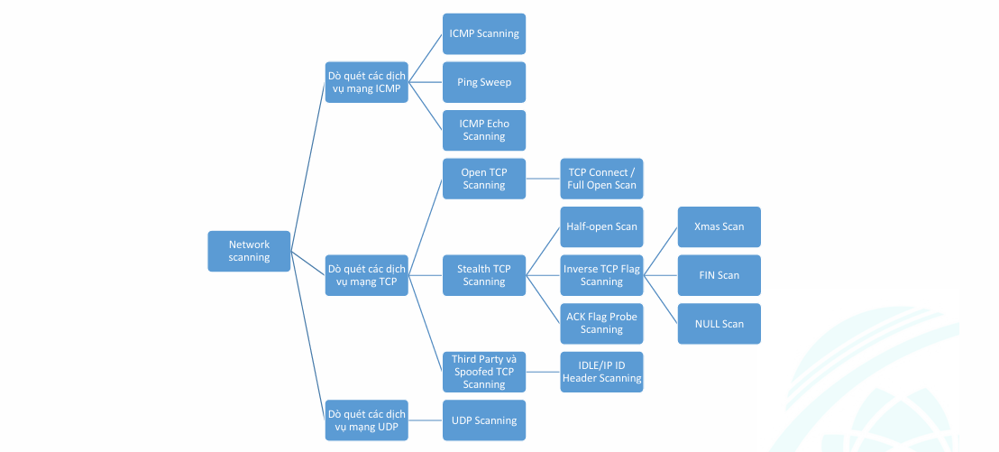
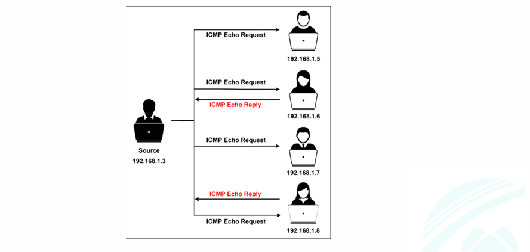
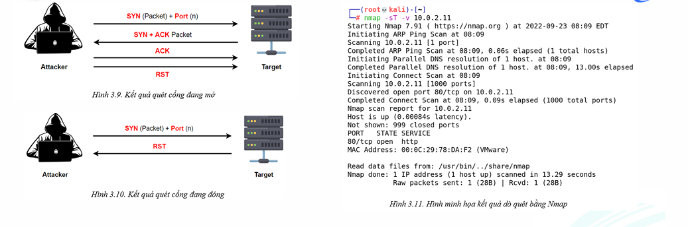
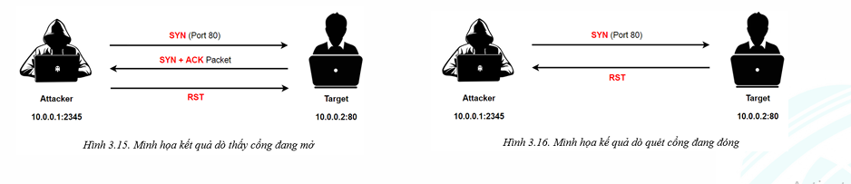
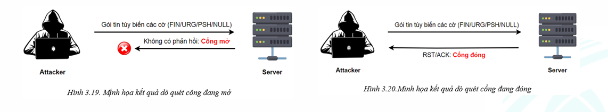
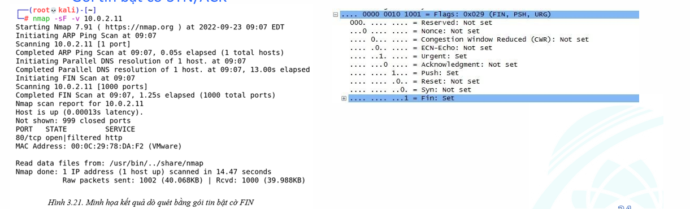
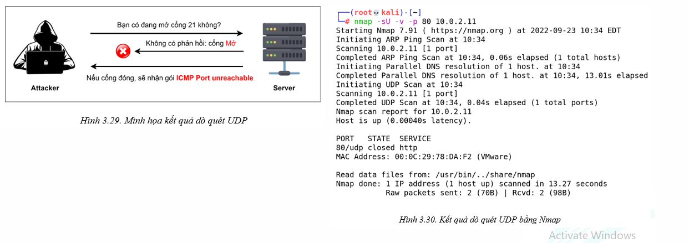
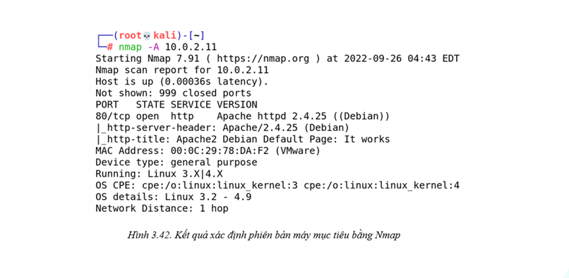

# Dò tìm lỗ hỏng bảo mật thông tin

## Các bước thực hiện 1 cuộc tấn công mạng

### Do thám

### Dò quét

+ Quá trình thu thập thông tin chi tiết bổ sung vào mục tiêu bằng các kỹ thuật trinh sát tích cực và phức tạp
+ Dò quét mạng: máy chủ, cổng và dịch vụ mạng
+ Giai đoạn quan trọng nhất -> tạo ra hồ sơ của tổ chức mục tiêu
+ Thu thập:
	+ IP
	+ HDH
	+ Kiến trúc
	+ Dịch vụ đang chạy
+ Mục đích: 
	+ Khám phá kênh giao tiếp có thể khai thác
	+ Thăm dò càng nhiều càng tốt
	+ Theo dõi những kênh đáp ứng hoặc hữu ích cho nhu cầu của kẻ tấn công
+ Tìm mọi cách khác nhau để xâm nhập 1 hệ thống mục tiêu
+ Tìm xem có bất kỳ lỗi cấu hình nào không
+ Sử dụng thông tin thu được để xây dựng chiến lược tấn công

#### Các loại dò quét:

+ Network scanning:

	+ Liệt kê IP
	+ Xác định các máy đang chạy trong hệ thống mục tiêu
	+ Bao gồm: tấn công mạng và đánh giá bảo mật mạng
	+ Mục tiêu:
		+ Xác định các máy tính đang chạy trong hệ thống mạng:
			+ Xác định IP và các máy đang chạy trong máy tính mục tiêu
			+ Biết được danh sách các cổng đang mở -> dịch vụ mạng đang chạy -> khả năng thâm nhập
		+ Xác định hệ điều hành và kiến trúc hệ thống của mục tiêu: 
			+ Biết -> kẻ tấn công có thể suy ra các nguy cơ bảo mật tương ứng
		+  Xác định các dịch vụ đang chạy hoặcđang ở trạng thái lắng nghe trong hệ thống mục tiêu:
			+ biết được các lỗ hổng tương ứng -> cách khai thác chúng để xâm nhập 
		+ Xác định ứng dụng và phiên bản của một dịch vụ cụ thể.
		+ Xác định lỗ hổng bảo mật của bất kỳ hệ thống mạng nào:
			+ tấn công hệ thống mục tiêu thông qua các kỹ thuật tấn công khác nhau

+ Port scanning:

	+ Liệt kê cổng được mở và các dịch vụ
	+ Kiểm tra các dịch vụ đang chạy trên máy tính mục tiêu = gửi một chuỗi tin nhắn để phân tích kết quả trả về
	+ Kết nối hoặc thăm dò cổng TCP và UDP -> trạng thái chạy hay lắng nghe
	+ Trạng thái nghe -> cung cấp thông tin HDH và ứng dụng đang sử dụng
	+ Trạng thái nghe -> cho phép người dùng trái phép -> truy cập hệ thống cấu hình sai hoặc chạy phần mềm có lỗ hỏng

+ Vulnerability scanning:

	+ Liệt kê lỗ hỏng bảo mật đã biết trên máy mục tiêu
	+ Kiểm tra xem hệ thống có tồn tại lỗ hỏng bảo mật nào hay không
	+ Trình dò quét lỗ hỏng bảo mật = công cụ dò quét + danh mục các lỗ hỏng biết trước cùng cách khai thác
	+ Kết quả: 
		+ giúp kẻ tấn công trong việc tìm cách tấn công hệ thống mục tiêu
		+ giúp nhà quản trị hệ thống biết cách và phát hiện lỗ hỏng

+ Các cờ trong TCP:
	+ SYN, ACK, FIN, RST, PSH, URG
	+ Bắt tay 3 bước: SYN, SYN - ACK, ACK

#### Các công cụ dò quét:

+ Nmap: `nmap -A -p 80,433 10.0.2.11`
+ Hping: cho phép tạo gói tin có cấu trúc chủ đích để thực hiện đánh giá bảo mật, kiểm tra tường lửa, kiểm tra đường đi, phát hiện thông tin hdh, dự đoán thời gian chạy và các chức năng khác. `hping3 -A 10.0.2.11 -p 80`
	+ Tính năng chính:
		+ Xác định máy tính có đang chạy hay không, kể cả chặn gói tin ICMP
		+ Xác định cổng đang mở, hiệu năng = giao thức, kích thước gói tin khác nhau
		+ Xác định các cổng đang mở trên các máy tính đặt phía sau tường lửa
		+ Xác định thông tin hệ điều hành
		+ Giám sát hoạt động chồng giao thức TCP/IP
	+ Một số tính năng của hping3
		+ ICMP Ping: `hping3 -1 10.0.0.1`
		+ ACK Scan trên cổng 80: `hping3 –A 10.0.0.1 –p 80`
		+ UDP Scan trên cổng 80: `hping3 -2 10.0.0.1 –p 80`
		+ SYN Scan trên cổng 50-60: `hping3 -8 50-60 –S 10.0.0.1 –V`
		+ FIN, PUSH, URG Scan trên cổng 80: `hping3 –F –P –U 10.0.0.1 –p 80`
		+ SYN flooding: `hping3 –S 192.168.1.1 –a 192.168.1.254 –p 22 --flood`

#### Các kỹ thuật dò quét mạng phổ biến:

+ Scanning: quá trình thu thập thông tin trên các thiết bị đang hoạt động
+ Port scanning:
	+ Giúp kẻ tấn công xác định được các cổng đang mở trên máy tính mục tiêu.
	+ Các quản trị viên dùng để kiểm tra các chính sách bảo mật của hệ thống mạng của họ. Giúp phát hiện các nguy cơ bảo mật sớm và có kế hoạch vá các lỗ hổng bảo mật kịp thời.
		+ Kiểm tra các máy tính đang hoạt động. 
		+ Kiểm tra các cổng được mở trên các máy tính đang chạy. 
		+ Xác định các lỗ hổng bảo mật nếu có
+ ICMP: 
	+ Dùng để gửi gói ICMP đến máy tính mục tiêu -> thu thập thông tin
	+ Xác định xem các máy tính trong mạng có đang chạy hay không (Nmap dùng tùy chọn P để thực hiện việc ICMP Scanning)
	+ Tăng số lượng lệnh ping một cách đồng thời -L
	+ Gửi ECHO request -> máy khác, máy khác -> ICMP ECHO reply nếu đang chạy. kiểm tra máy đang chạy và khả năng gói tin ICMP có qua được tường lửa

+ Ping sweep (ICMP sweep)
	+ Kỹ thuật dò quét các máy đang chạy trong hệ thống mạng
	+ Dùng hàng loạt các địa chỉ khác nhau
	+ Công cụ: NetScanTools Pro, Visual Ping Tester
	

	> `nmap -sn 10.0.2.11`

+ ICMP Echo scanning:
	+ ping tất cả các máy tính trong mạng mục tiêu
	+ Các máy tính đang chạy sẽ gửi các gói ICMP ECHO REPLY -> địa chỉ nguồn của gói tin ICMP Echo
	+ Linux dùng ICMP Echo
	+ TCP/IP phản hồi ICMP Echo trên linux, window gửi trực tiếp đến địa chỉ broadcast

	> `nmap -sn 10.0.2.11`

+ TCP Connect / Full open scan
	+ connection() -> các cổng trên máy mục tiêu
	+ Hoàn tất quy trình bắt tay 3 bước (không cần quyền quản trị)
	+ SYN -> SYN ACK: mở
	+ SYN -> RST: đóng
	

	> `nmap -sT -v -p 80 10.0.2.11`

+ Stealth scan (half open scan)
	+ máy dò quét sẽ gửi gói RST ngay khi nhận gói SYN+ACK từ máy mục tiêu
	+ Làm kết nối bị ngắt trước khi hoàn tất bắt tay 3 bước
	
	
	> `nmap -sS -v 10.0.2.11`

+ Inverse TCP Flag Scanning
	+ Gửi gói tin có FIN/URG/PSH bật hoặc không gói nào (null scan)
	+ Khi cổng mục tiêu mở -> không nhận phản hồi
	+ Khi cổng mục tiêu đóng -> RST
	
	+ Các chiến lược:
		+ FIN bật 
		+ FIN, URG, PUSH bật (XMAS scan)
		+ Không bật cờ nào (null scan)
		+ SYN/ACK bật
	

	> `nmap -sF -v 10.0.2.11`

	> `nmap -sX -v 10.0.2.11`

	> `nmap -sN -v 10.0.2.11`

+ UDP scanning	
	+ Có nhiều thách thức hơn
	+ Có thể sử dụng ICMP để kiểm tra xem một cổng có đang mở hay không.
	+ Gửi đến một cổng mà không có ứng dụng nào đang dùng nó -> Cổng không thể truy cập
	+ Bất kỳ cổng nào trả về thông báo lỗi ICMP này -> cổng đang được mở
	

	> `nmap -sU -v -p 80 10.0.2.11`

#### Xác định phiên bản hệ điều hành và ứng dụng

+ Banner grabbing: banner là thông tin chi tiết được hiển thị bởi máy chủ như loại và phiên bản phần mềm
+ Tạo lợi thế cho tội phạm mạng trong các cuộc tấn công mạng
+ OSINT (Open-source intelligence) -> thủ công/tự động
+ Là bước thiết yếu trong môi trường tấn công cũng như tấn công thực nghiệm
+ Có 2 phương thức: 
	+ FTP: kẻ tấn công để tải tập tin /bin/ls để kiểm tra kiến trúc của hệ thống
	+ TCP: dự đoán hdh và ứng dụng

+ Có 2 loại kỹ thuật:
	+ Chủ động: chồng giao thức IP của hệ điều hành. Các phản hồi được so sánh với cơ sở dữ liệu các dấu hiệu xác định phiên bản có trước.
	+ Bị động: nghe lén các gói tin liên quan đến thông tin của phiên bản hệ điều hành và ứng dụng. Ví dụ: trang web có phần mở rộng là .aspx, chúng ta có thể suy đoán ứng dụng web này được quản lý bởi dịch vụ IIS Server và hệ điều hành là Windows.
+ Cách cách giảm thiểu nguy cơ dò quét thông tin danh sách và phiên bản các ứng dụng của hệ điều hành:
	+ Cố tình cấu hình cung cấp thông tin phiên bản không chính xác khi có yêu cầu từ phía kẻ tấn công. Ví dụ: ServerMask -> thay đổi phiên bản. Cấu hình trong module mod-header của httpd.conf để thay đổi tên máy chủ
	+ Tắt các dịch vụ không cần thiết
	+ Cấu hình để ẩn thông tin phần mở rộng của các trang web. Ví dụ: .html, .asp -> .online

#### Các phương pháp giảm thiểu:

+ Cấu hình tường lửa và trình phát hiện xâm nhập -> lọc các gói tin quét
+ Chạy các công cụ dò quét mạng để kiểm thử
+ Cập nhật phiên bản mới nhất.
+ Cấu hình các tường lửa chống lại quá trình dò quét cổng, ngập lụt gói tin SYN
+ Cài đặt các công cụ phát hiện xâm nhập như Snort
+ Chỉ mở các cổng cần thiết, đóng tất cả các cổng không cần thiết
+ Kiểm tra không gian địa chỉ IP bằng TCP hoặc UDP scan
+ Đảm bảo các luật liên quan đến anti-scanning cà anti-spoofing được thiết lập.

#### Quy trình dò quét kiểm thử

| Thứ tự | Nội dung | Ghi chú |
| :---: | --- | --- |
| 1 | Dò tìm máy tính đang chạy | nmap, angry IP scanner,... |
| 2 | Dò quét các cổng | nmap, NetScanTools pro,... |
| 3 | Dò quét phía trước tường lửa và trình phát hiện xâm nhập | phân mảnh gói tin, định tuyến nguồn,... |
| 4 | Thu thập thông tin hệ điều hành | gói tin tuỳ biến và phân tích kết quả phản hồi |
| 5 | Vẽ sơ đồ mạng | Network Topology Mapper, OpManager,... |
| 6 | Ghi nhận các phát hiện | |

### Tấn công

### Duy trì cuộc tấn công

### Xoá dấu vết