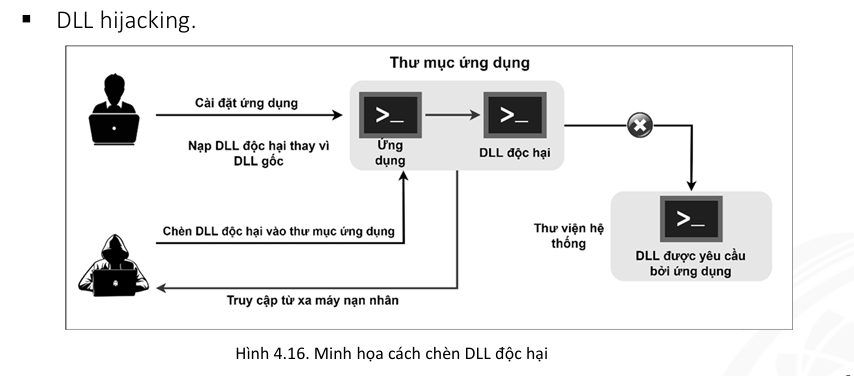

# Đảm bảo và an toàn thông tin trên hệ thống

## Quy trình tấn công hệ thống

`Do thám -> dò quét -> thống kê -> phân tích lỗ hổng -> bẻ mật khẩu -> leo thang quyền hạn -> thực thi phần mềm -> ẩn hành vi -> xoá dấu vết `

### Quy trình do thám:

+ Thu thập thông tin tên miền, danh sách địa chỉ email, dãy địa chỉ IP,…
+ Kỹ thuật Social engineering.

### Quy trình dò quét

+ Xác định các máy đang chạy

### Thống kê

+ Liệt kê các dấu hiệu có thể được sử dụng cho quá trình tấn công từ quá trình do thám và dò quét

### Phân tích lỗ hỏng

+ Kiểm tra khả năng bị tấn công của hệ thống và ứng dụng
+ Sau khi phân tích, kẻ tấn công tiến hành quá trình tấn công hệ 
thống

### Quá trình tấn công

+ Gồm 3 giai đoạn:
	+ Xâm nhập
	+ Duy trì xâm nhập
	+ Xoá dấu vết:

#### Xoá dấu vết

+ Là bước chính trong system hacking
+ Các kỹ thuật thường được dùng:
	+ Vô hiệu hoá kiểm kê (disable auditing)
		+ Để lại rất ít bằng chứng
		+ Làm hệ thống không ghi lại cuộc tấn công
		+ audiPol (có trong win NT)
	+ Xoá nhật ký sự kiện (Clearing logs)
		+ Dễ dàng xoá bỏ các bản ghi sự kiện trong Window event viewer
		+ Xoá các bản ghi sau khi vô hiệu quá kiểm kê
		+ Window Event viewer hoặc elsave.exe, winzapper, evidence eliminator
	+ Điều chỉnh nhật ký
	+ Xoá dấu vết trên mạng/hdh
		+ reverse http shell, reverse ICMP shell, DNS tunneling
		+ NTFS stream để ẩn và che dấu các tệp độc hại
	+ Xoá file (deleting files): Cipher.exe để xoá và ngăn chặn khôi phục dữ liệu
	+ Vô hiệu hóa chức năng Windows Fuctionality: thường vô hiệu hóa thời điểm truy cập cuối cùng, chế độ hibernation, bộ nhớ ảo, các điểm khôi phục hệ thống… 

### Vượt qua cơ chế đảm bảo và an toàn thông tin bằng cách bẻ mật khẩu

+ dò tìm mật khẩu từ dữ liệu lưu trữ trong bộ nhớ hoặc dựa vào dữ liệu được gửi đi trên mạng, các thông tin mô tả của chính sách mật khẩu của tổ chức.
+ Các kỹ thuật:
	+ Tấn công phi kỹ thuật: nhìn lén, lục thùng rác, tail gating
	+ Tấn công trực tuyến chủ động: vét cạn, thông qua từ điển, thông qua lừa đảo, trojan, spyware, keyloggers, Burpsuite,...
		+ Burpsuite: gửi hàng loạt các gói tin có tham số khác nhau.
			+ `Setup -> Cấu hình proxy Burpsuite(127.0.0.1:8080) -> cấu hình proxy trình duyệt -> Bắt gói tin proxy ở intercept -> thiết lập tấn công intruder -> điền danh sách mật khẩu (theo kỹ thuật tấn công theo từ điển) -> cấu hình chuyển hướng khi đăng nhập -> Kết quả gửi các yêu cầu (redirect = 0 là mật khẩu)`
	+ Tấn công trực tuyến thụ động: man in the middle attack, reply attack,... dùng wireshark, tcp-dumped
	+ Tấn công ngoại tuyến: Diễn ra khi kẻ tấn công có dữ liệu về mật khẩu. Dữ liệu có thể là mật khẩu bảo vệ tập tin, hoặc mật khẩu được mã hóa.
		+ Diễn ra trên bảng mã hoá cho trước (rainbow table attack): so sánh 2 chuỗi mã hoá -> hạn chế: password salting
		+ Tấn công dựa trên mạng phân tán: kẻ tấn công chép được dữ liệu cần bẻ mật khẩu

#### Cách hạn chế bị bẻ mật khẩu

+ Cấu hình chức năng theo dõi tình trạng bảo mật thông tin để theo dõi và ghi nhận việc tấn công bẻ mật khẩu.
+ Không dùng mật khẩu giống nhau trong quá trình đổi mật khẩu.
+ Không chia sẻ mật khẩu với người khác.
+ Không dùng mật khẩu tồn tại trong từ điển hoặc danh sách mật khẩu phổ biến.
+ Không dùng giao thức không mã hóa hoặc giao thức mã hóa yếu để truyền mật khẩu.
+ Giới hạn thời hạn cho mật khẩu. 
+ Tránh việc lưu mật khẩu ở những nơi không an toàn.
+ Không nên dùng mật khẩu mặc định.
+ Đảm bảo tính phức tạp của mật khẩu. 
+ Đảm bảo mật khẩu không được lưu ở dạng bản rõ vào bộ nhớ hay ổ cứng.
+ Dùng chuỗi ngẫu nhiên (Salt) vào đầu hoặc cuối mật khẩu trước khi mã hóa chúng.
+ Không dùng mật khẩu dễ đoán.
+ Thiết lập chính sách khóa mật khẩu sau một số lần đăng nhập thất bại.
+ Sử dụng Captcha để hạn chế việc đăng nhập tự động trong quá trình dò mật khẩu theo kỹ thuật vét cạn hoặc dùng từ điển.

### Vượt qua cơ chế đảm bảo và an toàn thông tin bằng leo thang quyền hạn

+ Là bước thứ hai trong quá trình tấn công hệ thống
+ Tài khoản bình thường -> nhiều quyền hơn
+ Có hai loại:
	+ Leo thang quyền hạn ngang
		+ Tài nguyên, chức năng dưới quyền của một tài khoản được xác thực.
	+ Leo thang quyền hạn dọc
		+ Tài nguyên, chức năng dưới quyền của một tài khoản có nhiều quyền hơn.
		+ Kẻ tấn công muốn leo quyền hạn dọc để thực hiện các bước tiếp theo: cài thêm mã độc, trojan, backdoor, rootkit
+ Một số kỹ thuật
	+ dll hacking
				
	+ Khai thác lỗ hỏng bảo mật
	+ Khai thác việc thiết lập quyền hạn không hợp lý
	+ Khai thác tính năng lập lịch của hệ điều hành
+ Quyền hạn kẻ tấn công > Hệ thống -> đánh cắp dữ liệu, cài phần mềm độc hại, truy cập tài nguyên bất hợp pháp, cài backdoor
+ backdoor, cracker, keylogger, spyware
+ RemoteExec, PDQ deploy, dameware remote support, psExec, the fat rat

#### Cách hạn chế tấn công leo thang quyền hạn

+ Cấp phát quyền hạn cho người dùng một cách vừa đủ.
+ Dùng kỹ thuật mã hóa mạnh để bảo vệ dữ liệu nhạy cảm.
+ Giảm thiểu số lượng các đoạn mã yêu cầu quyền đặc biệt.
+ Triển khai phương thức chứng thực, xác thực đa tác tử.
+ Kiểm lỗi mã nguồn ứng dụng.
+ Khởi chạy các ứng dụng bằng các tài khoản có quyền vừa đủ
+ Hạn chế người dùng tạo tập tin vào thư mục mặc định của các ứng dụng.
+ Thường xuyên theo dõi quyền hạn của hệ thống tập tin bằng cách dùng các công cụ theo dõi.
+ Tắt các ứng dụng và dịch vụ không cần thiết liên quan đến việc lập lịch.
+ Vô hiệu hóa tài khoản quản trị cục bộ.
+ Hạn chế việc thực thi ứng dụng với quyền quản trị.
+ Chỉ cho phép các cổng được chỉ định giao tiếp với các yêu cầu từ bên ngoài.
+ Bật chế độ ghi nhật ký để ghi nhận các tác vụ bất thường.
+ Kiểm tra lịch sử sử dụng tài nguyên hệ thống của các ứng dụng

### Che dấu các dấu hiệu của cuộc tấn công

+ Công cụ: rootkits, NTFS stream, kỹ thuật ẩn tin
+ Ví dụ: 
	1. chèn trojan.exe vào readme.txt: `type c:\trojan.exe > c:\readme.txt:trojan.exe`
	1. tạo liên kết đến trojan.exe: `mklink backdoor.exe readme.txt:trojan.exe`
	1. Khởi chạy trojan: `backdoor`

### Ví dụ minh hoạ quá trình tấn công

+ ping sweep hoặc net discovery

	> `nmap -sn 10.0.2.0/24`

+ Kiểm tra có bao nhiêu cổng được mở

	> `nmap -A -p- 10.0.2.11`

+ Thấy cổng 80 đang mở: 10.0.2.11:80

+ Xem cấu trúc thư mục web
	
	> `dirb http://10.0.2.11`

+ Truy cập thử

+ Kiểm tra loại tập tin vừa tải

	> `file backup`

	> `> zip`

+ Dùng công cụ fcrackzip để tìm mật khẩu

	> `fcrackzip -u -D -p rockyou.txt backup`

	> `> PASSWORD FOUND!!!!`

+ Giải nén tập tin bằng mật khẩu tìm được

	> `unzip backup`

+ Tìm thông tin trong dumb.sql

	> `cat dump.sql | grep root`

+ Tạo tập tin chứa các mã hash trong tập tin dumb.sql > drupal.txt

	> root:\*...

	> webman:\*...

+ Dùng john the ripper
	
	> `john --wordlist=diction.txt drupal.txt`

	> `john --show pass.txt`

+ Truy cập trang web bằng tài khoản